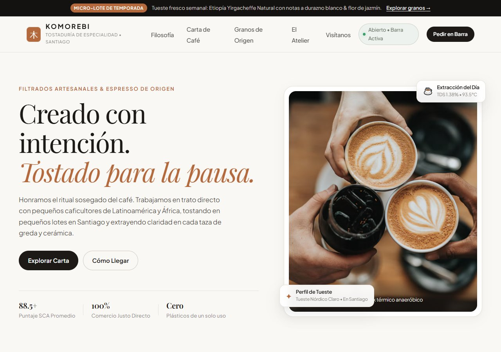
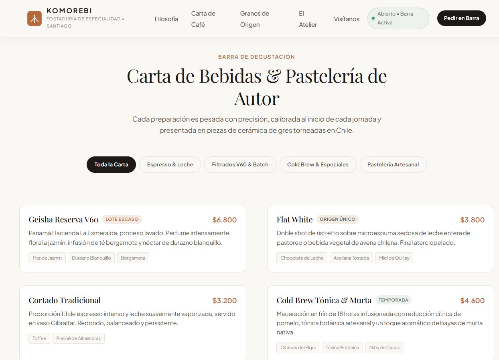
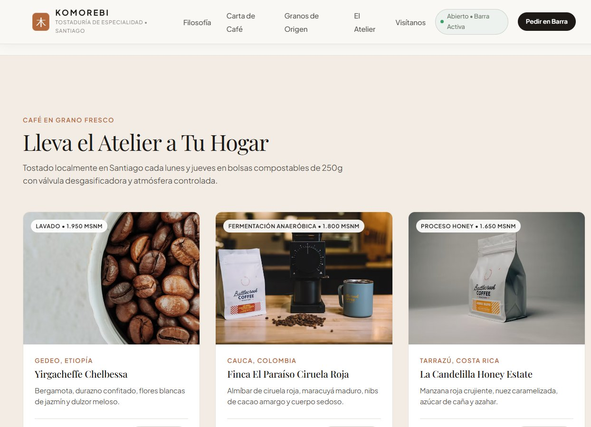
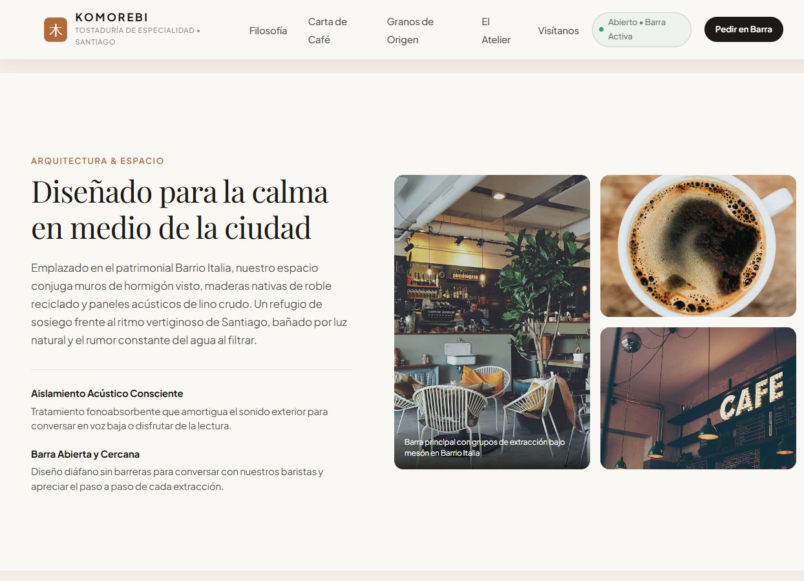
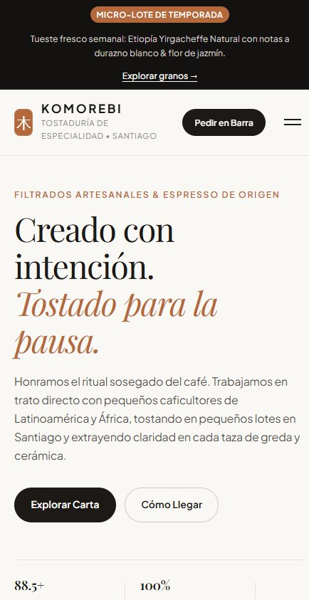

<div align="center">

# ☕ Komorebi — Tostaduría de Café

**Atelier de café de especialidad en Barrio Italia, Providencia · Santiago de Chile**

Sitio web *one-page* de alto detalle visual construido con HTML5 semántico, CSS3 moderno (metodología BEM) y JavaScript vanilla. Sin frameworks, sin bundler y sin dependencias: se abre y funciona.


</div>

---

## 🖼️ Vista previa

**Portada — escritorio**



**Carta interactiva y granos de origen**

| Carta con pestañas de filtrado | Micro-lotes de temporada |
| --- | --- |
|  |  |

**Arquitectura & espacio**



**Vista móvil**



---

## ✨ Sobre el proyecto

Komorebi es la web de una tostaduría de café de especialidad: micro-lotes de origen, tueste nórdico de precisión y un espacio pensado para la contemplación. El sitio traduce esa idea a una interfaz de **minimalismo cálido** (*Japandi* adaptado a Santiago), con una carta interactiva, granos de origen, arquitectura del local y una invitación clara a visitarlo.

Todo el contenido vive en un único `index.html` con navegación por anclas internas, y la interactividad se resuelve con un solo archivo JavaScript de ~140 líneas.

## 🚀 Cómo verlo

No requiere instalación ni build. Dos formas:

```bash
# Opción 1: clonar y abrir index.html directamente en el navegador
git clone https://github.com/4ndr3z18/Komorebi-Cafe.git
cd Komorebi-Cafe
start index.html        # macOS: open index.html

# Opción 2: servirlo con cualquier servidor estático (recomendado)
npx serve .
# o
python -m http.server 8080
```

Al ser un sitio 100 % estático, también es compatible con **GitHub Pages, Netlify, Vercel o Cloudflare Pages** sin ningún paso de compilación.

## 🧭 Secciones del sitio

| Sección | Ancla | Contenido |
| --- | --- | --- |
| Hero | `#hero` | Aviso de micro-lote de temporada y llamada a la acción |
| Filosofía | `#about` | El manifiesto del oficio y los tres pilares: trato directo con el origen, tueste nórdico de precisión y agua de cordillera re-mineralizada |
| Carta de café | `#menu` | Barra de degustación con pestañas de filtrado y tarjetas de producto con notas de cata |
| Granos de origen | `#roastery-beans` | Micro-lotes de Etiopía, Colombia y Costa Rica con altitud, proceso y precio por 250 g |
| El Atelier | `#space` | Arquitectura y espacio: aislamiento acústico consciente y barra abierta |
| Visítanos | `#visit` | Ubicación, horarios de barra, contacto y próxima cata abierta |
| Newsletter | `#newsletter-form` | Suscripción a *El Extracto Dominical* con validación en vivo |
| Footer | `#current-year` | Navegación secundaria, orígenes y año dinámico |

## 🧩 Características de interacción

- **Encabezado reactivo al scroll:** eleva el header y aplica desenfoque (`backdrop-filter`) al superar los 20 px de desplazamiento.
- **Menú drawer móvil accesible:** se abre y cierra actualizando `aria-expanded` y `aria-hidden`, y se cierra solo al tocar cualquier enlace.
- **Pestañas de filtrado de la carta:** cinco categorías (*Toda la Carta, Espresso & Leche, Filtrados V60 & Batch, Cold Brew & Especiales, Pastelería Artesanal*) que filtran las tarjetas por `data-category` y gestionan `aria-selected`.
- **Sistema de notificaciones toast:** micro-interacción al añadir un producto a la bolsa, con temporizador que reinicia en cada acción.
- **Formulario de newsletter con feedback en español:** valida vacío y formato, enfoca el campo con error y confirma el alta con un mensaje de éxito.
- **Año dinámico** en el pie de página y **cata abierta** destacada con fecha.

## 🎨 Sistema de diseño

### Paleta

| Rol | Color | Uso |
| --- | --- | --- |
| Lienzo | `#FAF8F5` | Pergamino / lino suave, fondo principal |
| Superficies | `#FFFFFF` · `#F2ECE4` | Tarjetas y bloques de contraste limpio |
| Texto | `#1C1917` | Carbón tostado profundo |
| Acento ámbar | `#B4693D` | Caramelo y extracción espresso |
| Acento botánico | `#6B7A6A` · `#EEF2EE` | Verde salvia suave |
| Contraste nocturno | `#141210` | Barra superior y pie de página |

### Tipografía

- **Títulos:** `Playfair Display` — serif editorial refinado.
- **Interfaz y cuerpo:** `Plus Jakarta Sans` — sans-serif geométrica y legible.
- **Escala fluida** implementada con `clamp()`, sin saltos bruscos entre resoluciones.

### Arquitectura CSS

- **53 custom properties** como *design tokens* (`--color-*`, `--space-*`, `--radius-*`, `--shadow-*`).
- **Metodología BEM estricta** (`bloque__elemento--modificador`), sin utilidades globales.
- **Mobile first** con breakpoints progresivos en `480`, `640`, `768`, `860`, `900`, `992`, `1024` y `1040` px.

## ♿ Accesibilidad y buenas prácticas

- Marcado semántico completo: `<header>`, `<nav>`, `<main>`, `<section>`, `<article>`, `<footer>`.
- *Skip link* («Saltar al contenido principal») y anillo de foco visible en toda la interfaz.
- Estados dinámicos expuestos a lectores de pantalla con `aria-expanded`, `aria-hidden`, `aria-selected` y `aria-label`.
- Contraste de texto validado sobre las superficies claras y oscuras del sistema.
- Sin dependencias de red más allá de Google Fonts, cargada con `preconnect` y `display=swap`.

## 📁 Estructura

```
Komorebi-Cafe/
├── index.html      # Estructura completa del sitio (one-page)
├── styles.css      # Tokens, reset, layout y componentes BEM (~1.600 líneas)
├── app.js          # Interactividad: scroll, drawer, filtros, toast y newsletter
├── docs/           # Capturas de pantalla usadas en este README
├── .gitattributes  # Normalización de finales de línea
└── README.md
```

## 🛠️ Stack técnico

| Capa | Tecnología |
| --- | --- |
| Estructura | HTML5 semántico |
| Estilos | CSS3 nativo — custom properties, `clamp()`, grid y flexbox, BEM |
| Interacción | JavaScript ES6+ vanilla (`'use strict'`, `passive` listeners) |
| Build | Ninguno — cero dependencias y cero bundler |
| Tipografías | Google Fonts (`preconnect` + `display=swap`) |

## 📌 Estado y próximos pasos

**Estado:** sitio completo y navegable. Listo para publicarse.

Ideas para seguir iterando:

- [x] Añadir capturas de pantalla al README.
- [ ] Publicar una demo en vivo con GitHub Pages.
- [ ] Carrito con persistencia (`localStorage`) para que «Añadir a Bolsa» sea una compra real.
- [ ] Formulario de newsletter conectado a un servicio real.
- [ ] Mapa embebido de la ubicación en la sección Visítanos.
- [ ] Añadir `LICENSE` y metadatos `og:`/Twitter Card para compartir mejor el enlace.

## 📄 Nota

Proyecto de diseño y desarrollo web con fines de demostración. La marca, los precios, las catas y los datos de contacto son **contenido ficticio**: la dirección y los teléfonos no corresponden a un comercio real.

---

<div align="center">

**Komorebi Tostaduría de Café** · Barrio Italia, Providencia, Santiago de Chile
Inspirados en la luz que se filtra entre los cafetales ☕

</div>
